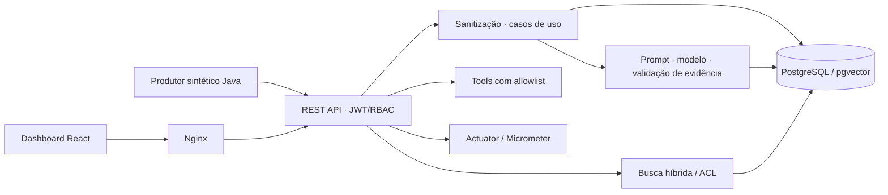

# TracePilot

Investigação de incidentes em **Java 21, Spring Boot e Spring AI**, com diagnóstico estruturado e evidências verificadas no material fornecido. Inclui dashboard React, recuperação híbrida com PostgreSQL/pgvector, JWT, métricas e uma demonstração reproduzível em Docker.

> Projeto de portfólio com dados sintéticos. A demo padrão usa um modelo determinístico, sem chave paga. A integração com uma LLM real é opcional. Kafka ainda é uma evolução planejada.


## Demonstração em um comando

Pré-requisito: Docker Engine com Compose v2 recente (`--wait`; o override de LLM usa `!override`). Não é necessário instalar Java, Node ou PostgreSQL no host.

```bash
docker compose -f compose.demo.yml --profile showcase up --build -d
```

- **Dashboard:** http://localhost:8081
- **Swagger:** http://localhost:8080/swagger-ui/index.html
- **Saúde:** http://localhost:8080/actuator/health

Um produtor Java externo alterna cinco cenários, com intervalo de dez segundos entre ciclos: conexão recusada, timeout, HTTP 503, estado de pedido inválido e cache recuperado por fallback. Ele usa a API, registra incidentes e solicita análises. No dashboard, filtre pelo mapa de serviços, busque na fila e selecione um incidente para investigar diagnóstico, evidências e ações. Use Novo incidente para escolher entre cinco cenários, pause a atualização quando quiser e alterne entre temas claro e escuro.

```bash
# Encerrar a demonstração deste Compose
docker compose -f compose.demo.yml --profile showcase down
```

As portas são vinculadas a `127.0.0.1`. Para evitar conflitos, defina `API_PORT` e `DASHBOARD_PORT` antes de iniciar. O banco da demo é efêmero: recriar o container descarta os dados.

## O que demonstra

| Decisão | Comportamento verificável |
|---|---|
| Evidências obrigatórias | Trechos citados precisam existir no material fornecido; resposta inválida gera 503 |
| Casos de uso e portas | Integrações HTTP, persistência e modelo ficam separadas dos casos de uso |
| Sanitização na entrada | Credenciais conhecidas e e-mails são redigidos antes da persistência de incidentes e dos embeddings de documentos |
| JWT, papéis e tenants | Escrita, leitura, análise e operação têm papéis distintos; consultas a incidentes de outro tenant retornam 404 |
| Recuperação híbrida | Busca vetorial e lexical com ACL e avaliação de Recall@k, MRR e source precision |
| Tools controladas | Allowlist, parâmetros fechados, orçamento, timeout e cache por investigação |
| Operação reproduzível | Healthcheck, backend sem root, filesystem de runtime somente leitura e CI de backend/frontend/E2E |



Arquitetura e decisões: [visão técnica](docs/architecture.md), [ADRs](docs/decisions/), [specs](specs/README.md) e [contrato futuro de eventos](docs/events/incident-analysis-requested-v1.md).

## Testes e evidências

```bash
# Aceitação HTTP em ambiente isolado, com build e limpeza automática
./scripts/run-demo-e2e.sh

# Backend: Java 21 + Docker para Testcontainers
./mvnw --batch-mode verify

# Frontend: Node 24
cd frontend
npm ci
npm test
npm run build
```

O build Docker do frontend também executa seus testes. Para repetir o smoke test de navegador com a showcase aberta (Python + `uv`, com `npm ci` executado em `frontend/` para disponibilizar o axe-core):

```bash
uv run --with playwright playwright install chromium
uv run --with playwright python scripts/browser-smoke.py
```

Ele testa cenários, análise, filtros, exportação, teclado, modais, recuperação de falha, temas, mobile e movimento reduzido. Executa axe em quatro estados e salva capturas e JSON em `output/playwright/`. Veja a [revisão UI/UX e as skills instaladas](docs/ui-ux-review.md). A suíte E2E verifica os cinco cenários e os níveis Leve/Médio/Alto, histórico, JWT/RBAC, isolamento por tenant, validação, sanitização, RAG, allowlist/cache de tools, correlation ID e métricas OPS. O script verifica ainda o HTML e o proxy da interface. Cada execução usa um projeto Compose novo, portas aleatórias e banco independente, sem alterar uma showcase já aberta.

Relatórios em `artifacts/demo/<run-id>/`: Markdown, JSON, JUnit com casos individuais e NDJSON com método/caminho/status. Tokens, cabeçalhos, corpos HTTP e logs brutos não são incluídos nesses relatórios. [Detalhes da suíte](docs/demo/e2e-suite.md) · [Resultados desta revisão](docs/verification.md).

O [workflow CI](.github/workflows/ci.yml) executa backend, frontend, testes das ferramentas e E2E em pull requests e pushes para `main`.

## Massas de teste

A [massa versionada](demo/fixtures/events.ndjson) contém 30 eventos inteiramente sintéticos, seis por cenário. Cada linha é um payload para `POST /api/v1/demo/log-events`, com token de `INCIDENT_WRITER`. A suíte E2E ingere essa massa pela API.

```bash
# Python 3.12+; não lê dados de produção e não sobrescreve arquivos existentes
python3 scripts/generate-test-data.py --count 1000 --seed 42 --output /tmp/incident-events.ndjson
python3 -m unittest discover -s scripts -p 'test_*.py'
python3 -m unittest discover -s demo/runner -p 'test_*.py'
```

A mesma seed e quantidade produzem os mesmos bytes. Limite: 1 a 10.000 eventos. O gerador cria arquivos; não faz carga contra serviços externos nem mede capacidade de produção.

## Segurança e limites

A demo é **local**. `GET /local/demo-token?role=INCIDENT_WRITER&tenant=demo` emite um token sintético de uma hora no profile `local`. Outros papéis: `INCIDENT_READER`, `ANALYST`, `OPS`. O emissor local e as credenciais públicas do Compose servem à demonstração; para implantação real, remova esse profile, configure identidade e `APP_SECURITY_JWT_SECRET` com chave privada de pelo menos 32 bytes, TLS e controles de rede.

A sanitização é uma defesa por padrões: JSON e pares chave/valor de senha/token/API key, autorização Basic/Bearer, credenciais em URLs e e-mails. Não é um detector universal de PII, não corrige registros anteriores e não substitui revisão antes de publicar dados. Stack traces e auditoria completos não são campos públicos; evidências podem apresentar trechos sanitizados.

O RAG e as tools têm endpoints auxiliares apenas nos profiles de demo. A análise padrão usa o incidente; não promete executar automaticamente uma investigação RAG completa. O modelo determinístico demonstra contratos e falhas, sem medir qualidade de uma LLM. A confiança exibida na demo é um valor do cenário, não uma probabilidade calibrada. Não há Kafka, outbox implementada nem processamento assíncrono em execução.

## LLM real via API compatível com OpenAI

Ollama usa o mesmo adapter Spring AI OpenAI e o endpoint `/v1/chat/completions`. O modelo padrão deste profile é `qwen2.5-coder:7b`; ele precisa estar instalado no Ollama do host. Não há fallback silencioso para o modelo determinístico: falhas da chamada ou evidência inválida retornam 503.

Para iniciar **LLM real + Prometheus + Grafana** juntos, preservando o profile correto:

```bash
LLM_PROFILES=local,llm,observability docker compose -p investigator-validation \
  -f compose.demo.yml -f compose.observability.yml -f compose.llm.yml \
  --profile showcase --profile observability up --build -d --wait
```

UI: `http://localhost:8081`; API: `http://localhost:18080`; Grafana: `http://localhost:3000`. Login local inicial do Grafana: `admin/admin`, com troca solicitada no primeiro acesso. O dashboard fica na pasta **TracePilot**. O acesso depende de iniciar os serviços de observabilidade; o link sozinho não inicia o Grafana.

O último arquivo deve ser `compose.llm.yml`, e `LLM_PROFILES` deve incluir `observability` ao combinar os três arquivos. A configuração de observabilidade isolada usa o modelo determinístico, por isso a ordem importa. Na interface, confira **Modelo da análise**: históricos determinísticos continuam identificados como demonstração; análises novas exibem o modelo real que as produziu.

Para trocar de provedor compatível, configure `AI_BASE_URL`, `AI_API_KEY` e `AI_MODEL`. Neste adapter Spring AI, a URL-base não inclui `/v1`: o caminho padrão adicionado é `/v1/chat/completions`. A aplicação pede JSON tipado e continua validando as evidências. Não versione chaves.

## Perfis opcionais separados

```bash
# Ollama com modelo instalado, ou provedor compatível configurado por ambiente
docker compose -f compose.demo.yml -f compose.llm.yml --profile showcase up --build -d
# API: http://localhost:18080; dashboard: http://localhost:8081

# Prometheus e Grafana para a demo determinística
docker compose -f compose.demo.yml -f compose.observability.yml --profile showcase --profile observability up --build -d
```

LLM: `AI_BASE_URL` (padrão `http://host.docker.internal:11434`), `AI_API_KEY` e `AI_MODEL` (padrão `qwen2.5-coder:7b`). Não versionar chaves em arquivos. A execução com provedor real depende de disponibilidade e qualidade do modelo. Há uma validação local real registrada em docs/verification.md; o CI E2E continua determinístico.

Grafana: http://localhost:3000, credenciais locais iniciais `admin/admin`, troca solicitada no primeiro acesso. O profile `observability` abre Prometheus internamente para scraping e é exclusivo de demonstração. Fora dele, métricas exigem `OPS`; health e info são públicos.

Para desenvolvimento Java local: `docker compose up -d postgres` e `./mvnw spring-boot:run -Dspring-boot.run.profiles=local`. Esse profile isolado não configura um modelo; para a experiência completa, prefira a showcase Docker.

## Apresentar no LinkedIn

Use o [roteiro de vídeo e texto do post](docs/presentation/linkedin.md), a [apresentação técnica](docs/presentation/tracepilot.md) e o [roteiro HTTP](docs/demo/portfolio-walkthrough.http). Demonstre a falha explícita e os testes junto com a interface: são parte central da proposta.

## Contribuição

Consulte [CONTRIBUTING.md](CONTRIBUTING.md) para branches, PR automático, validações e regras de publicação.
