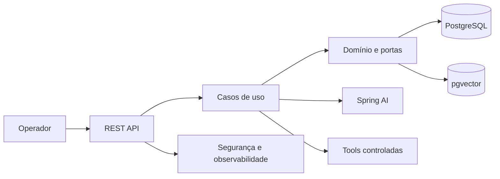
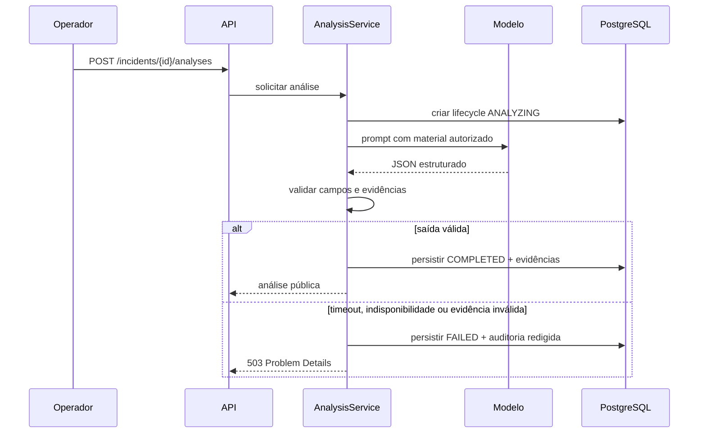
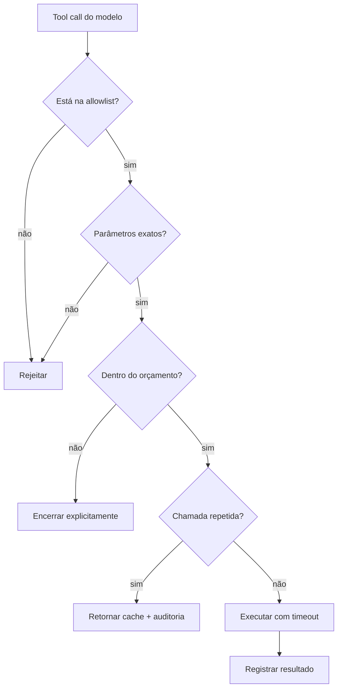
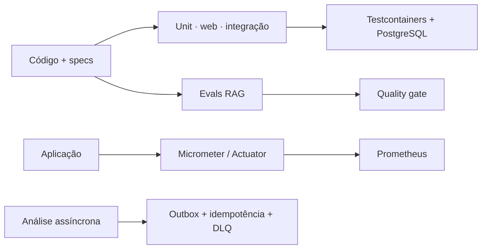

# TracePilot

## Diagnóstico de incidentes com IA, evidência e controle operacional

Projeto de portfólio em Java 21, Spring Boot, Spring AI, PostgreSQL e pgvector.

---

## O problema

Em incidentes técnicos, uma resposta gerada por IA só é útil se for:

- verificável por uma pessoa responsável;
- limitada aos dados autorizados;
- segura contra vazamento de credenciais;
- observável e reproduzível;
- capaz de falhar explicitamente, sem inventar uma explicação.

---

## A proposta

O TracePilot recebe um incidente técnico e produz um diagnóstico estruturado, com causa provável, confiança, recomendações e evidências que precisam existir no material fornecido.

Não é um chatbot genérico: o domínio é investigação de incidentes, e as integrações com IA e ferramentas estão atrás de contratos controlados.

---

## Arquitetura



Diagrama completo: [`docs/architecture/incident-investigator-flow.mmd`](../architecture/incident-investigator-flow.mmd).

---

## Separação de responsabilidades

| Camada | Responsabilidade |
|---|---|
| `api` | HTTP, DTOs públicos e Problem Details |
| `application` | casos de uso, transações, prompts e orquestração |
| `domain` | modelos, invariantes e portas |
| `infrastructure` | JPA, pgvector, Spring AI, JWT e métricas |
| `evaluation` | datasets versionados e métricas de qualidade |

As dependências apontam para dentro: infraestrutura depende da aplicação; aplicação depende do domínio.

---

## Fluxo de análise



---

## RAG: recuperação antes de geração

1. O conteúdo é sanitizado e dividido por um chunker determinístico.
2. Cada chunk recebe embedding e hash; a deduplicação de documentos inclui o escopo ACL.
3. A consulta combina busca vetorial e full-text search.
4. O ranker híbrido aplica ACL, limiar e `topK`.
5. A qualidade é avaliada com Recall@k, MRR e source precision.

Isso cria uma base mensurável para melhorar prompts ou modelos sem depender de percepção subjetiva.

---

## Tools: IA sem acesso irrestrito



Tools disponíveis: inspeção de stack trace, incidentes semelhantes e documentação indexada. Não há shell, SQL livre, URL arbitrária ou acesso externo por ferramenta.

---

## Segurança e privacidade

- Resource server JWT com papéis `INCIDENT_WRITER`, `INCIDENT_READER`, `ANALYST` e `OPS`.
- Tenant vem exclusivamente do claim do token; acesso cross-tenant é respondido como 404.
- Incidentes e documentos passam por redaction de padrões conhecidos de tokens, senhas, API keys, autorização, URLs com credenciais e e-mails; auditoria tem defesa adicional.
- Respostas públicas omitem stack traces completos, prompts e auditoria. Evidências podem mostrar trechos sanitizados; redaction por padrões não é uma garantia universal.
- Métricas usam tags de baixa cardinalidade e não registram conteúdo sensível.

---

## Operação e qualidade



Kafka é uma evolução planejada, não uma dependência adicionada sem contrato de entrega e reprocessamento.

---

## Demonstração local

```bash
docker compose -f compose.demo.yml --profile showcase up --build -d
```

1. Solicite um JWT sintético em `GET /local/demo-token?role=INCIDENT_WRITER`.
2. Execute o roteiro [`docs/demo/portfolio-walkthrough.http`](../demo/portfolio-walkthrough.http).
3. Explore o contrato em `/swagger-ui/index.html`.
4. Consulte saúde e métricas pelo Actuator.

---

## O que o projeto evidencia

- Uso prático de IA com limites, validação e fontes verificáveis.
- Decisões arquiteturais documentadas por ADRs e specs.
- Segurança aplicada também ao domínio, não apenas ao filtro HTTP.
- Evolução incremental: primeiro contrato e testes; depois integração e operação.
- Clareza sobre limites atuais, evitando prometer capacidades não expostas.

---

## Estado e próximos passos

O dashboard e a suíte E2E containerizada estão implementados. A demo usa um modelo e embeddings determinísticos para tornar verificáveis os contratos de análise e recuperação; ela não mede qualidade semântica de uma LLM.

A análise padrão recebe o incidente. Os endpoints de RAG e tools demonstram componentes de investigação separadamente, sem prometer que toda análise percorre esses componentes automaticamente.

Evoluções: autenticação por provedor externo, processamento assíncrono com outbox/idempotência/DLQ e avaliação com modelos reais. Publicação em produção exige remover emissor local e credenciais de demonstração.

[Aceitação HTTP](../demo/e2e-suite.md) · [Exemplos de requisições](../demo/portfolio-walkthrough.http).

---

## Perguntas

Repositório, decisões e roteiro de demo estão documentados para facilitar revisão técnica e discussão arquitetural.
