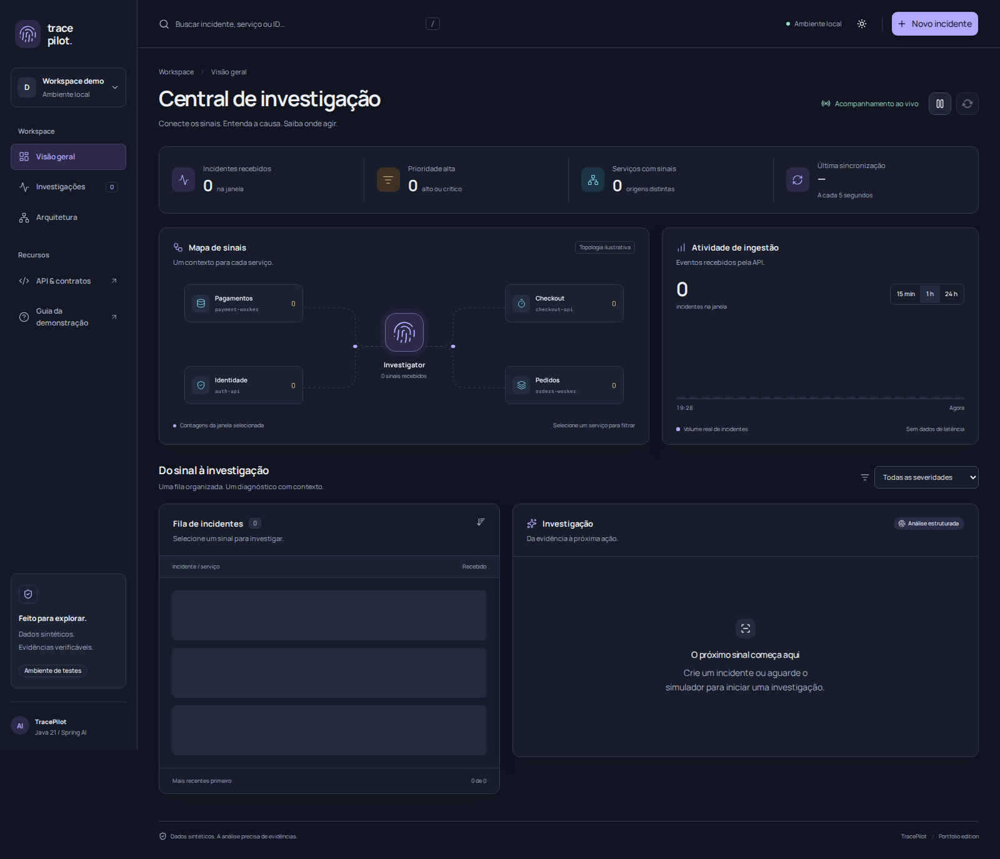

# Revisão de UI/UX — Central de investigação

A showcase foi redesenhada como um workspace de investigação. Está conectada aos endpoints existentes; filtros, criação, análise, histórico e exportação usam os dados da aplicação. O mapa representa um agrupamento visual ilustrativo por serviço, sem alegar descoberta automática de topologia ou disponibilidade.



[Ver tema claro](presentation/dashboard-light.png) · [Ver mobile](presentation/dashboard-mobile.png) · [Relatório de navegador e axe](verification/ui-report.json)

## Skills instaladas globalmente

As seis skills foram instaladas em no ambiente local de desenvolvimento com o instalador de skills. Serão descobertas automaticamente nos próximos turnos; suas instruções já foram lidas e aplicadas nesta revisão.

| Recurso solicitado | Skill / origem | Aplicação |
|---|---|---|
| Frontend Design | `frontend-design`, [Anthropic](https://github.com/anthropics/skills/tree/main/skills/frontend-design) | Direção visual, hierarquia e composição |
| Vercel React Best Practices | `react-best-practices` (nome interno `vercel-react-best-practices`), [Vercel](https://github.com/vercel-labs/agent-skills/tree/main/skills/react-best-practices) | Cliente HTTP, deduplicação de tokens, estado e efeitos |
| Web Design Guidelines | `web-design-guidelines`, [Vercel](https://github.com/vercel-labs/agent-skills/tree/main/skills/web-design-guidelines) | Revisão de foco, estados, navegação, tipografia e movimento |
| Playwright | `playwright`, [OpenAI](https://github.com/openai/skills/tree/main/skills/.curated/playwright) | Verificação em Chromium, screenshots e fluxos |
| Tailwind CSS + shadcn/ui | `shadcn`, [shadcn/ui](https://github.com/shadcn-ui/ui/tree/main/skills/shadcn) | Tailwind v4 e componentes oficiais Radix/shadcn no projeto |
| Accessibility Audit | `accessibility`, [Web Quality Skills](https://github.com/addyosmani/web-quality-skills/tree/main/skills/accessibility) | Axe, contraste, semântica, teclado e movimento reduzido |

Tailwind e os componentes foram adicionados ao frontend; não são plugins globais do navegador. O CLI shadcn foi usado para gerar os componentes e removido das dependências da aplicação: sua cadeia transitiva introduzia alertas sem ser necessária ao runtime. Os helpers CSS oficiais foram preservados, com atribuição MIT, em `frontend/src/components/ui/primitives.css`.

## Decisões de interface

- Paleta de ardósia e violeta, com ciano para evidências e cores semânticas para severidade. Temas claro e escuro compartilham os mesmos tokens.
- Manrope e IBM Plex Mono auto-hospedadas, sem requisição a um serviço externo de fontes.
- Navegação lateral, busca com atalho `/`, seleção explícita na fila e detalhe de investigação no mesmo contexto.
- Mapa de serviços como filtro interativo. O gráfico agrupa eventos reais em 24 intervalos; o usuário escolhe 15 minutos, uma hora ou 24 horas.
- Abas de diagnóstico, evidências e ações. Recomendações podem ser marcadas nesta sessão; nenhuma mudança operacional é executada por esse checklist.
- Criação em modal com cinco cenários e prévia do evento, análise sob demanda, cópia e exportação JSON.
- Atualização a cada cinco segundos, com pausa e refresh manual. A pausa afeta a interface; o produtor externo continua enviando eventos.
- Busca, serviço, severidade, período e seleção são refletidos na URL. O tema é a única preferência persistida em localStorage; tokens ficam somente em memória.
- Erros incluem uma ação de recuperação, e falhas de criação aparecem dentro do modal.

## Correções verificadas

`frontend/src/hooks/use-investigation.ts` — refreshes anteriores são abortados ao iniciar uma mutação. Uma resposta atrasada não remove mais o incidente recém-criado nem troca sua seleção. Os erros de ação não são apagados por um polling bem-sucedido.

`frontend/src/components/scenario-dialog.tsx` — falhas de POST permanecem no modal, visíveis a teclado/leitor de tela, com a ação de tentar novamente disponível.

`frontend/src/components/ui/tabs.tsx` — o texto das abas inativas usa o token de texto secundário, sem a transparência que produzia contraste de 4,13:1 no tema claro.

`frontend/src/components/incident-queue.tsx` — a lista inicial não usa renderização adiada por `content-visibility`; esse recurso fica restrito à expansão acima de 48 itens. Isso preserva a captura e a apresentação da fila mobile.

`frontend/nginx.conf` — Swagger e contrato OpenAPI funcionam pelo mesmo host da interface, inclusive seus assets; arquivos estáticos versionados têm cache longo.

## Evidências

- **17 testes frontend aprovados**, incluindo busca/limpeza, severidade, seleção por serviço, estado vazio, pausa, cenários, offline/retry, tema, histórico, seleção durante análise, resposta atrasada e erro no modal.
- Build TypeScript/Vite aprovado no container Node 24. JavaScript final em torno de **129 KB gzip**, conforme o build; esse tamanho não é uma medida de Core Web Vitals.
- **27 registros E2E aprovados** na aplicação containerizada, incluindo os contratos de API e a verificação do HTML/proxy.
- Chromium: cenário de timeout e banco, análise, evidências, ações marcáveis, exportação JSON, busca sem resultado, filtro por serviço, persistência do tema e recuperação de falha de conexão.
- Teclado: skip link, atalho de busca, foco contido/restaurado em modal e navegação por setas nas abas.
- Layout a 390 px e viewport de 800 px como aproximação de espaço disponível a 200% de zoom. Sem overflow horizontal nos estados testados.
- Axe com tags WCAG 2 A/AA, 2.1 AA e 2.2 AA: **zero violações reportadas** no modal, desktop escuro, desktop claro e mobile escuro com movimento reduzido.
- Auditoria npm após remover a dependência do CLI: **zero vulnerabilidades reportadas** no momento da consulta.
- Revisão de código independente: dois problemas relevantes reproduzidos, corrigidos e revisados novamente sem novos achados relevantes.

## Reproduzir

```bash
docker compose -f compose.demo.yml --profile showcase up --build -d
# http://localhost:8081

cd frontend
npm ci
npm test
npm run build
cd ..
uv run --with playwright playwright install chromium
uv run --with playwright python scripts/browser-smoke.py
./scripts/run-demo-e2e.sh
```

Os testes de navegador usam o wrapper Python já existente no projeto e `axe-core` instalado em `frontend/node_modules`. Capturas e JSON da execução ficam em `output/playwright/`, ignorados pelo Git; os arquivos desta apresentação são cópias selecionadas com dados sintéticos.

A instância entregue nesta sessão usa o projeto Compose `investigator-validation`, disponível em `http://localhost:8081`. Para encerrá-la: `docker compose -p investigator-validation -f compose.demo.yml --profile showcase down`.

## Limites

A auditoria automatizada não certifica conformidade WCAG integral. Não houve teste com leitor de tela humano, Safari ou Firefox, nem medição de Core Web Vitals sob rede/dispositivo controlados. O teste de 800 px não substitui testar todos os níveis de zoom em diferentes browsers. LLM real, descoberta de topologia e métricas de latência não são simuladas como funcionalidades existentes.
